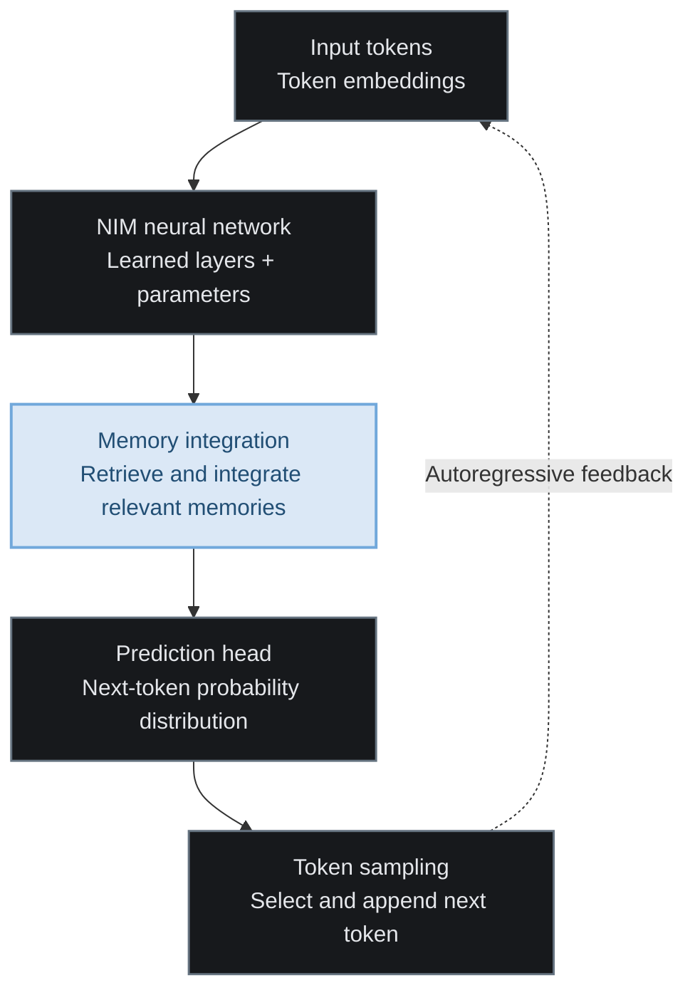
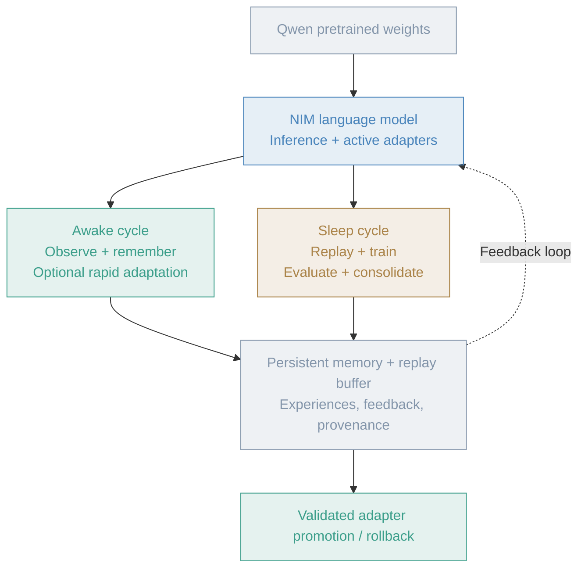

# Neural Intelligence Mesh

A continual-learning multi-modal language model.

This projects goal is to model how the human brain functions as closely as possible
using small models, large models, and equivalent transports.

## What Does This Mean?

1. Small/large models are used to mimick how different regions of the brain work.
2. Those different regions communicate with one another as a DAG in the same way our brains do.
3. Data is modelled/stored as similarly to how the human brain stores it as possible.

## Why?

I've long since been curious if by modeling a system like this after the human brain we could create
a more intelligent, self sufficient, and cost effective/performant intelligence.

Rephrased, can you make/train a general purpose intelligence model built on a network of 
smaller models more speicific to one given task?

