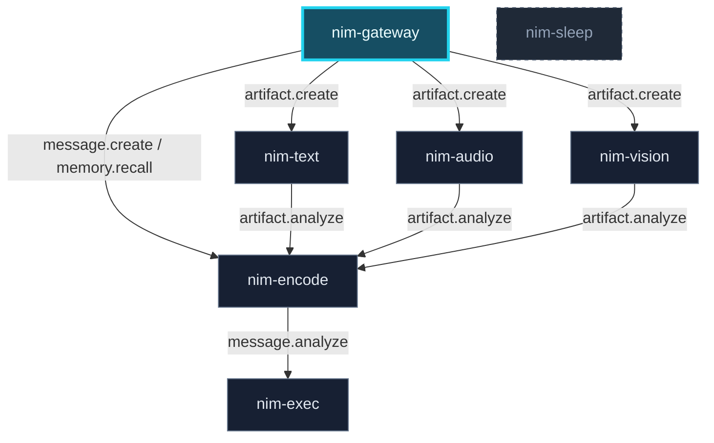

# Gateway

The ingress service. It exposes the HTTP and web UI surface, persists chats,
messages, and artifacts, publishes workflow signals, and forwards chat, message,
and memory updates to connected sockets.

## Service Mesh

Arrows show logical signal flow. This service is highlighted.

## Responsibilities

- Serves `/health`, search, artifact, memory, chat, and web-view routes.
- Routes text, audio, and visual artifacts to their modality worker.
- Publishes `nim.chat.*`, `nim.message.*`, and `nim.memory.recall` signals.

## Current limits

- Unknown artifact types are published but have no worker.
- The gateway does not execute inference.
