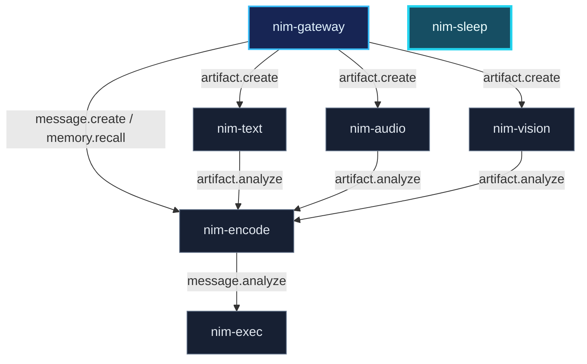

# Sleep

The scheduled consolidation service. It runs every five minutes.

## Service Mesh

Arrows show logical signal flow. This service is highlighted.

## Current status

The service connects, then exits. Consolidation and learning are not implemented.

## Planned responsibilities

## NREM

During NREM sleep, coordinated cortical slow oscillations, thalamic spindles,
and hippocampal sharp-wave ripples reactivate recent experience. This is thought
to stabilize and redistribute memory traces from hippocampus toward neocortex.[^1]

### Memory Consolidation

Memory consolidation is the stabilization and reorganization of newly encoded
memories, supported during NREM by coordinated hippocampal replay and cortical
oscillations.[^1] NIM can replay candidate experiences, strengthen useful traces,
and consolidate summaries and embeddings into longer-lived representations.

### Memory Relationship Management

In neuroscience, reactivation is thought to integrate new memories with related
prior knowledge and schemas—not to create explicit symbolic edges.[^1] NIM can
use this as an analogy for evaluating and revising memory relationships.

### Entity/Fact Extraction

Sleep supports abstraction and schema integration, but it does not perform
literal entity or fact extraction. This stage can derive structured entities and
claims from consolidated representations as an engineering approximation.

## REM

### Learning

REM's theta-dominant physiology supports synaptic plasticity and may refine or
integrate memory representations across NREM–REM cycles. Its exact computational
role remains unsettled.[^2]

### Creativity

REM has been associated with associative recombination, insight, and creative
problem solving; the evidence is suggestive rather than a settled mechanism.[^3]
NIM can use it for controlled recombination and evaluation of related memories.

[^1]: [Brodt et al., *Neuron* (2023)](https://pubmed.ncbi.nlm.nih.gov/37023710/)
[^2]: [Shuster et al., *Sleep Advances* (2025)](https://pubmed.ncbi.nlm.nih.gov/40161405/)
[^3]: [Landmann et al., *Neurobiology of Learning and Memory* (2015)](https://pubmed.ncbi.nlm.nih.gov/25602929/)
