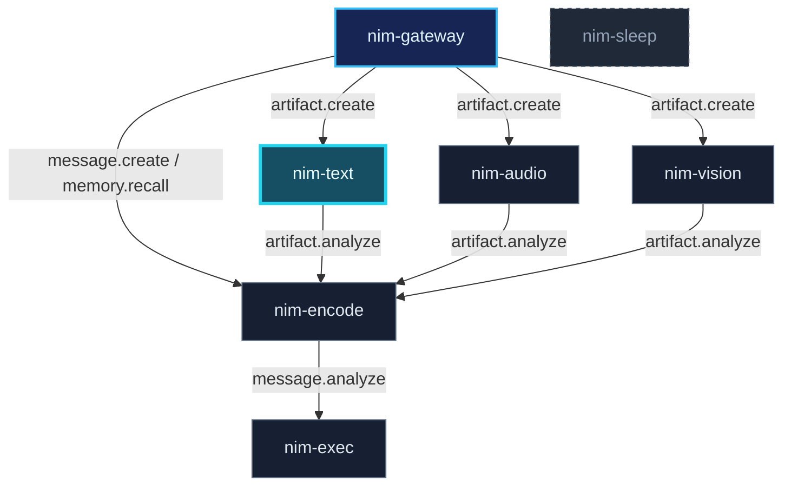

# Text

Processes text artifacts into summaries, embeddings, annotations, and linked
working memories.

## Service Mesh

Arrows show logical signal flow. This service is highlighted.

## Responsibilities

- Consumes `nim.text.artifact.create`.
- Summarizes and embeds text; extracts entities, keywords, and label annotations.
- Creates or updates a linked working memory.
- Emits `nim.artifact.create`, `nim.artifact.analyze`, and `nim.memory.{create|update}`.
